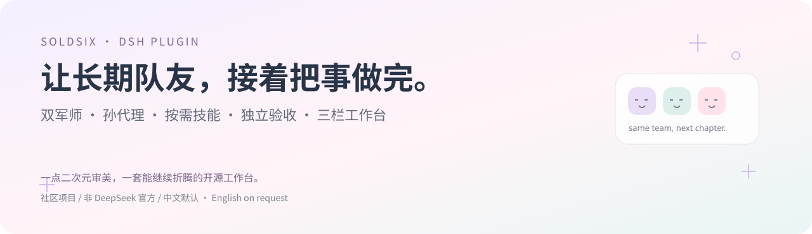
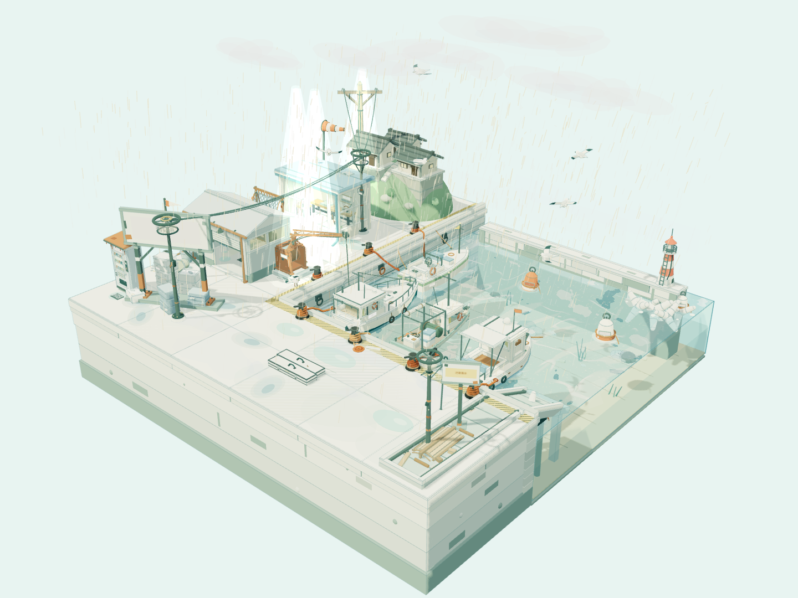

# DSH Team Workbench



[中文（默认）](README.md) · **English**　|　[Releases](https://github.com/Soldsix/dsh-team-workbench/releases) · [Installation](docs/installation.md) · [UI](docs/ui.md) · [Tests](docs/test-report.md)

Hi, I’m Soldsix. I’m a cosplayer with an anime habit, a fondness for cute boy outfits, and rather too many ideas for tools. I wanted to keep talking to a model I enjoy using while a persistent team handles the work and advisers help with the difficult decisions.

That turned into a practical list of questions: who is idle, who owns this file, why is a finished task running again, and what survives a model change or restart? This workbench puts the people, plan, tasks, evidence and deliverables in one place so the next step stays visible.

This is an independent community **DSH Plugin**, maintained by Soldsix, with no affiliation to DeepSeek AI. The public root candidate is `dsh-team-workbench@0.5.0-rc.2`, using the validated V5 team runtime. The supported host is **DSH 0.2.1-rc.2 exactly**.

## What it looks like


Members, advisers and hierarchy on the left; grouped tasks and dependencies in the middle; model routes, roles, skills, memory and evidence on the right. The complete plan can be inspected before execution. Preparing, failed and cooling-down members remain inspectable. More actual screenshots are in the [UI guide](docs/ui.md).

The repository opens in Chinese by default. This English page is an explicit manual choice; the plugin itself follows the host’s locale and theme.

## What is included

- Retained members and Sessions, including nested teams and explicit parent roles.
- User-selected communication models and per-member model/reasoning configuration. Model context and output limits stay with the existing DSH connection.
- Planning and quality advisers for specific milestones. Advisers review decisions; they do not take execution tasks.
- Ready-work dispatch, dependency waits, connection/model concurrency pools and explicit exclusive browser/device resources.
- Private working sets, immutable input/output receipts, independent acceptance and checked shared publication.
- Model changes that retain member identity, Session and completed tasks; active requests finish with their current route.
- An on-demand catalog of 56 skill entries with per-member context budgets and mode-skill compatibility.
- Persisted task, delivery and recovery records, with meaningful waiting and failure states.

These are application mechanisms with limits. A model can still make a poor decision, and arbitrary privileged tools can bypass cooperative file coordination. The deployment notes below matter as much as the feature list.

## Install

This release targets public GitHub listing first. It has **not been published to npm**, so it is not claimed to be available in DSH’s in-app plugin center. The root package includes its name, version, ESM `apply(ctx)` entry, bundle metadata and prebuilt runtime files.

For a new isolated web profile:

```text
dsh plugin --profile web add github:Soldsix/dsh-team-workbench
```

Or download the complete release archive:

```text
dsh plugin --profile web add ./dsh-team-workbench-0.5.0-rc.2.tgz
```

Before changing an existing profile, finish or preserve its work, back it up and stop its Host. Installation does not restart a service. Existing tool, sandbox and network patches need the [migration/rollback guide](docs/installation.md) and [public-root package notes](docs/public-package.md).

DSH 0.2.2-rc.1 failed declaration compatibility checks and is unsupported. Other versions are not automatically supported; do not widen peer ranges to force an installation.

## First project

1. Start the supported profile and open the newly printed login URL. Keep that URL private.
2. Choose your existing mode, communication model and reasoning setting.
3. Describe the goal, available inputs and deliverables. Ask the model to read `team_help start`.
4. Inspect the complete roster, models, skills, task graph, output ownership, resource budget and acceptance criteria. Confirm the exact plan version.
5. Follow execution and review on the board. Actual outputs are submitted, another member reviews them, and critical milestones require both adviser decisions.

For example: “Review this small project with my configured models. Separate API, test and documentation work. Show the plan first, assign file ownership before writing, and use an independent reviewer for the result.”

## Make it yours

The communication role is not tied to a particular provider or a fixed thinking level. Execution roles resolve the model’s highest supported reasoning setting by default. Unknown aliases are not guessed into other models.

Roles, instructions, models, skills, hierarchy, request pools, private working sets and exclusive resources are configurable. See [examples](examples/) and [customization](docs/customization.md). DSH replaces a row’s entire `config`, so preserve every field you intend to keep.

The skill catalog exposes names and purposes before loading detailed text. Members select only the modules needed now, with the default limit of four selections. Versions and content digests stay with the task. Existing mode-skill priority and model visibility remain respected. Read the [skills handbook](docs/skills.md) for the full catalog and behavior.

## A real project

The harbor example used the same 37 retained members across five rounds, including 32 component authors. Their first submissions were frozen separately; real screenshots and browser measurements informed later revisions.

| First submissions | After five rounds |
| --- | --- |
|  |  |

The first round ended with 34 accepted tasks; five rounds reached 71. Twenty of the 32 components differ from the frozen first submissions. “One round” does not mean one API call per author. One frozen component was later rejected and corrected within R1, so the first artifact set is not a claim that every first submission passed.

The test driver supplied scaffolding, interfaces and fixed decomposition. The advisers had separate Sessions and decisions, but used the same model in this experiment. Neither fact should disappear from the story.

At the recorded main view, draw calls changed from 7,426 to 5,169 and geometries from 3,842 to 2,076. The final checks include 14 detail views and 26 controlled animation timestamps. These are specific observations, not a universal frame-rate guarantee. The [case study](docs/harbor-case-study.md) includes source, actual pictures, motion evidence and limitations.

Both standalone HTML scenes are in [demos/harbor/standalone](https://github.com/Soldsix/dsh-team-workbench/tree/main/demos/harbor/standalone). Three.js, scripts, procedural textures and models are embedded; offline file and sandboxed iframe checks passed.

## Evidence and limits

The internal V5 candidate passed 1,492 local tests with two platform-conditional skips, plus an actual Windows/Linux × Node 22/24 hosted matrix. Separate checks covered 8/20/32-member flows, model changes, rejection, handoff, rollback, Windows shell/path behavior, and three hours of keyless idle/cold-recovery testing.

The rc.2 public root changes packaging and presentation. Internal package references are relocated, with input and output hashes checked; new package-install results are recorded separately in [public package notes](docs/public-package.md). Earlier green checks are not presented as proof of a new package layout.

The three-hour run was an idle and periodic-recovery test, not an indefinite high-load guarantee. Tool errors, missing inputs, upstream 502s and review rejections remain in the evidence. The package includes no personal modes, model accounts, persona documents, private Sessions, keys or browser credentials and does not upload diagnostics automatically.

Search still needs a functioning provider and approved network scope. MCP servers and devices need their own setup. Cooperative locks cannot confine arbitrary privileged shell/MCP tools. Cross-machine scheduling, real-billing hard budgets, universal task success and semantic deduplication are not promised.

## Contributing

Bring reproducible bugs, interface ideas, compatibility tracks or better skills. Include versions and redacted diagnostics; leave private prompts, Sessions, model requests and keys out of public issues.

Development uses Node `^22.19 || >=24` and the fixture described in [CONTRIBUTING](CONTRIBUTING.md). The independently tested runtime stays under `packages/team`; the root is the installable public package. Checks keep the two synchronized.

[Issues](https://github.com/Soldsix/dsh-team-workbench/issues) · [Security reporting](SECURITY.md) · [MIT license](LICENSE) · [Upstream notices](NOTICE.md)

If this saves you one round of explaining the same project again or recovering somebody’s overwritten file, I’m happy I made it. — Soldsix
