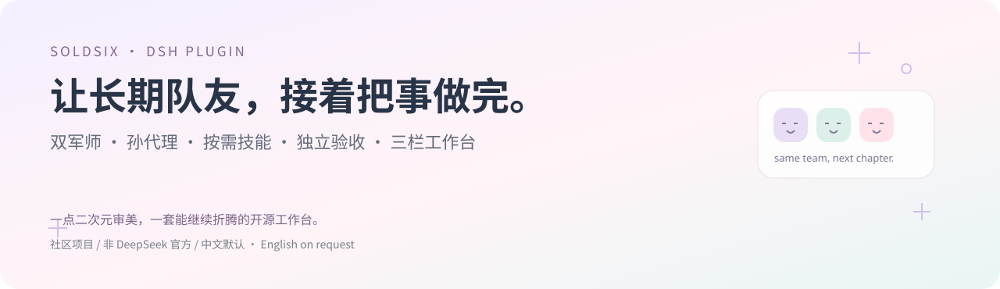
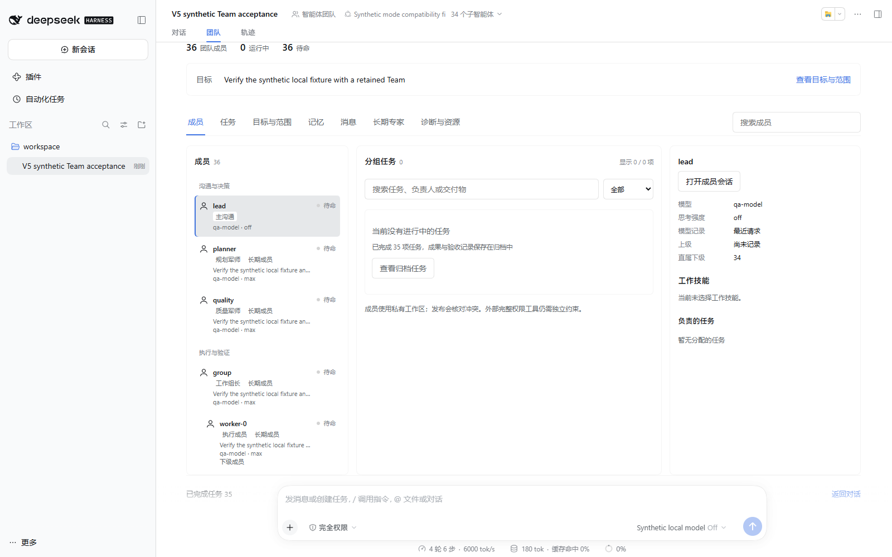
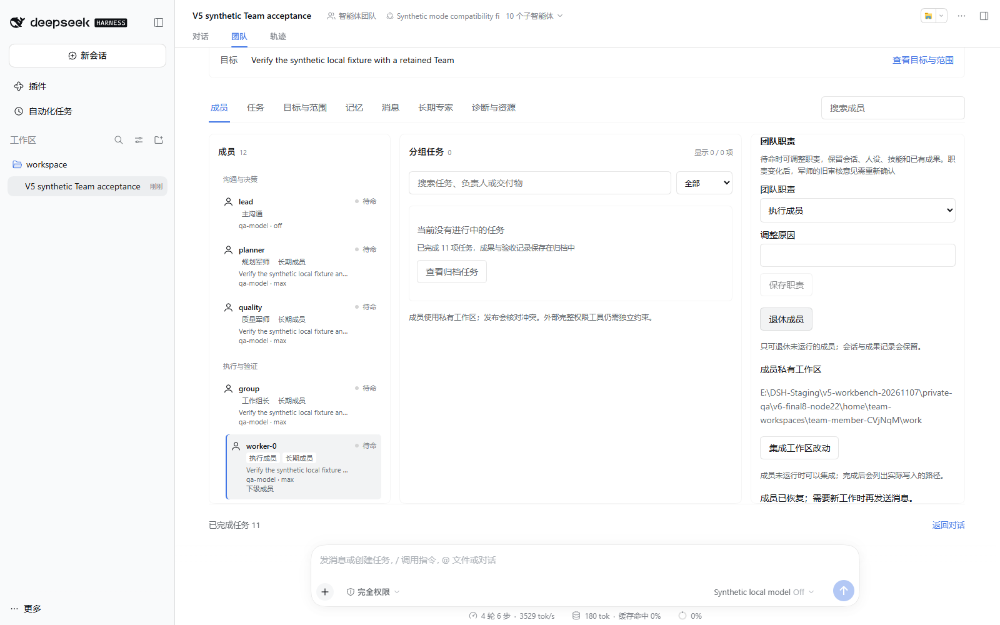

# DSH 团队工作台



**中文** · [English](README.en.md)　|　[下载发行包](https://github.com/Soldsix/dsh-team-workbench/releases) · [安装指南](docs/installation.md) · [真实界面](docs/ui.md) · [测试与限制](docs/test-report.md)

这里是 Soldsix，一个喜欢二次元、出 cos，也喜欢把工具折腾顺手的男娘 coser。这个项目的起点很简单：我想和自己选的主模型好好聊天，让一队长期成员接住复杂项目，军师在需要判断的时候给出靠谱意见。

做着做着，问题就具体起来了：队友为什么闲着？刚验收的结果怎么又重跑？换了模型，身份和记忆还能接上吗？文件到底归谁写？所以才有了现在这套工作台。它把成员、任务、方案、证据和成果放在一起，让接下来该做什么有迹可循。

这是一个**社区维护的 DSH Plugin**，不隶属于 DeepSeek AI，也不冒充官方项目。当前公开候选包为 `dsh-team-workbench@0.5.0-rc.2`，使用已验证的 V5 团队运行时；**宿主精确支持 DSH `0.2.1-rc.2`**。

## 先看工作台



左边看长期成员、军师和上下级，中间看分组任务、依赖和验收进度，右边看角色、模型、技能、记忆与交付证据。完整方案在执行前可展开核对；准备中、失败或冷却中的成员也能查看原因。



实际界面、窄屏与暗色截图在[界面说明](docs/ui.md)；上面的图片来自真实宿主流程。插件跟随 DSH 的语言与主题设置，这份仓库主页默认中文，英文需要点击顶部链接手动打开。

## 它能帮你做什么

| 你关心的事 | 工作台里的做法 |
| --- | --- |
| 主模型好沟通，复杂判断交给更合适的模型 | 主沟通者由你选择；规划与质量军师分别审关键节点，军师不领取执行任务 |
| 队友做完一次就丢掉，下一轮重新解释 | 成员保留身份、Session、任务和检查点；没任务时待命，下一轮继续派给原成员 |
| 一个模型没额度，要换模型继续 | 原位修改下一次请求的模型与思考档，保留成员 ID、会话、已完成任务和角色记录 |
| 项目需要更多方向并行 | 组长可在已确认的层级、人数与资源预算内委派下级；成员总量、驻留量与请求并发分开限制 |
| 20 个队友同时改同一个文件 | 使用任务归属、私有工作区、内容回执和受检查的发布；发现冲突后保留双方成果，交给合并任务 |
| 任务看似完成，但没有真正验证 | 成果由其他成员验收；关键里程碑还需要规划与质量两份决定，决定绑定具体执行版本 |
| 技能很多，提示词越来越长 | 先查名称和用途，再按当前任务选择正文；阶段切换保存检查点，避免全目录常驻上下文 |
| 重启、限流、工具故障后不知道从哪里接 | 任务与投递状态持久保存，恢复时区分活动、完成、等待依赖、额度冷却和待处理工作 |

这些机制都有适用范围。模型依然可能误用工具或判断失误；系统管理员、完整权限 shell 和独立外部工具也能绕过应用内文件协调。具体限制放在后面，方便你部署前一起看。

## 安装：先选对宿主和包

当前走 **GitHub 公开收录**，尚未发布 npm，因此暂不宣称已经进入 DSH 内置插件中心。仓库根目录提供真实插件包名、版本、ESM `apply(ctx)` 和 profile bundle 元数据，源码自带编译产物，不要求部署者重新构建 DSH。

全新、独立的 `web` profile 可以使用 GitHub 源码入口：

```text
dsh plugin --profile web add github:Soldsix/dsh-team-workbench
```

也可以下载 Release 中的完整安装包后安装：

```text
dsh plugin --profile web add ./dsh-team-workbench-0.5.0-rc.2.tgz
```

**修改正在使用的 profile 前，先处理好任务、备份并停止对应 Host。** 安装命令不负责重启，也不会替你关闭旧任务。已有自定义工具、网络或沙箱补丁时，请先读[安装与回滚](docs/installation.md)以及[公开根包迁移说明](docs/public-package.md)。

`0.2.2-rc.1` 的声明兼容检查未通过，本版不支持；其他未验证版本也不应靠改 peer 范围强装。官方 DSH 与这个插件各自升级，请对照[兼容矩阵](docs/compatibility.md)。

## 第一次怎么用

1. 启动已安装插件的 DSH profile，打开新打印的登录地址。登录 URL 属于凭据，不要放进 issue。
2. 选择你原来的模式、主模型和思考档。插件不要求你换人设，也没有强制的模型供应商。
3. 用自然语言讲清目标、输入和想收到的成果，让模型先读 `team_help start`。
4. 执行前打开完整方案，核对成员、模型、技能、任务依赖、输出文件、资源和验收标准，批准这一版。
5. 在任务板跟踪结果。成员有实际成果后提交，其他成员验收；需要你决定的问题会单独显示。

例如：“用我配置的模型审查这个小项目，分开检查接口、测试和文档；先给完整计划，写文件前标清归属，最后由另一位成员验收。”

这个例子只是开始方式。插件不会凭一句话自动得到你电脑上所有工具，也不会把其他项目的授权、账号或敏感数据带过来。

## 角色、模型和资源，留给你自己决定

主沟通者可以是你习惯的任意已配置模型，思考也不限定为关闭。执行成员默认解析为模型支持的最高思考档；上下文与输出上限沿用宿主连接。模型的别名不会被擅自猜成另一个型号。

你可以调整成员模型、军师职责、组长层级、角色指令、技能、并发池、私有工作集、浏览器和设备的独占资源。示例在 [examples](examples/)，完整字段见[自定义指南](docs/customization.md)。DSH patch 会替换整行 `config`，复制配置时要保留仍需使用的字段。

固定角色与可复用专家档案分开。军师平时不空转，也不替执行者写代码；正常派工、等待和唤醒由程序调度。闲置不等于错误，工作台会区分没有就绪任务、等待依赖、等待资源、等待额度以及可继续却未派发的情况。

## Skills：有目录，也有上下文预算

随包提供 **56 项技能目录入口**，包括团队操作、交接与质量工程，以及开发、产品/UI、研究、浏览器、移动端、设备指纹、微信小程序、长篇创作和运维恢复等方向。模式原有 skills 的优先级与模型可调用属性继续保留。

成员先通过 `team_skill_catalog` 找到准确名称，再选择当前阶段需要的模块。默认按每人最多四项的预算控制；细节参考资料按需读取。选中版本和内容摘要会跟随任务保存，避免运行途中换了一份技能正文还误当作原来的依据。

完整说明在[Skills 专册](docs/skills.md)。技能是方法和检查清单，实际工具、浏览器、MCP、手机或模拟器仍需要部署者接入并验证。

## 一个真的跑过的项目

我们让同一批 **37 名成员**合作制作太阳雨小渔港，其中 32 位负责独立组件。首份提交单独保存，再依据真实截图和运行数据继续四轮修订。

| 首次提交的场景 | 五轮后的场景 |
| --- | --- |
|  |  |

首轮结束时有 34 项最终验收任务，五轮累计 71 项；32 份组件中 20 份相对冻结首稿改变。这里的“一轮”是每位作者第一次正式提交，不是每人只调用一次 API。首稿保留了一个后来被退回修改的滑道版本，不能写成“32 份初稿全部首次通过”。

场景骨架、固定分工与外部浏览器检查由测试驱动提供。双军师是独立会话和决定，但这组实验中全部使用同型号模型，也不能冒充不同模型的独立投票。

实际主视角样本中 drawCalls 从 7,426 降到 5,169，geometries 从 3,842 降到 2,076。最终还有 14 个细节视角、26 个受控时刻与动作核对；它们说明这些具体条件下的结果，不代表所有硬件的 FPS 保证。源码、图片、动作和剩余不足在[完整案例](docs/harbor-case-study.md)。

两个成品另有自包含 HTML：脚本、Three.js、贴图生成与模型全部内嵌，断网直开和沙箱 iframe 检查通过，可从 [demos/harbor/standalone](demos/harbor/standalone/) 下载查看。

## 测试证据怎么读

V5 内部运行时的原候选版完成了本机 **1,492 项测试、2 项平台条件跳过**；对应的 Windows/Linux × Node 22/24 四组 hosted CI 已运行通过。另有 8/20/32 成员流程、原位换模、独立退回、文件交接、安装回滚、中文空格路径和三小时无密钥待命/冷恢复检查。

本次 `0.5.0-rc.2` 调整的是公开根包、GitHub 源码安装入口与介绍，内部运行代码另做字节核对；新增根包的实际安装结果在[公开包说明](docs/public-package.md)。旧版本通过的结果不自动等于新包装已经通过，报告分别记录。

三小时测试是待命与周期冷恢复，不是连续高负载或无限运行承诺。模型过程中的权限拒绝、输入缺项、上游 502 和复核退回都保留；不把最后交付成功写成从未失败。详见[测试报告](docs/test-report.md)与[CI 页面](https://github.com/Soldsix/dsh-team-workbench/actions)。

## 部署前，几件必须知道的事

- 插件包不携带你的模式、人设、模型连接、会话、密钥或浏览器账号；也不自动上传诊断。
- 搜索需要可用的 provider 和目标允许的联网范围。安装工作台不会自动获得搜索服务或 MCP 凭据。
- 私有工作区、输入版本和发布锁约束的是协作插件流程；完整系统权限的外部 shell/MCP 不在这层锁的保证范围内。
- 本版没有跨机器调度、真实账单硬预算，也不能保证任意专业任务一次成功或语义上绝不重复。
- 升级与回滚必须保留新产生的 Session 和成果，不要用旧备份整目录覆盖当前数据。

## 开发与参与

欢迎带着可复现的问题来，也欢迎改 UI、补兼容轨道或细化技能。请附宿主/插件版本、复现步骤和脱敏诊断，不要上传完整人设、私有 Session、模型请求或密钥。

开发使用 Node `^22.19 || >=24`，按照 [CONTRIBUTING](CONTRIBUTING.md)准备锁定依赖和受支持的 DSH fixture。`packages/team` 保留独立运行时源码；仓库根目录是面向安装和社区扫描的公开包，两者通过校验脚本保持一致。

问题走 [Issues](https://github.com/Soldsix/dsh-team-workbench/issues)，安全问题请看 [SECURITY](SECURITY.md)。项目采用 [MIT](LICENSE)，上游声明保留在 [NOTICE](NOTICE.md)。

如果这套小队刚好让你少重复解释几遍需求、少找一次被覆盖的文件，那这份折腾就挺值的。—— Soldsix
