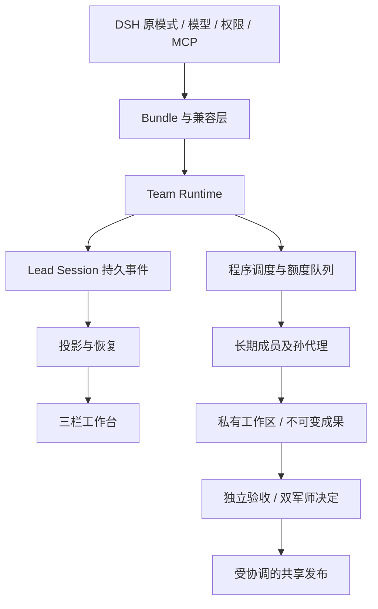

# 架构与数据责任

## 概要

工作台是一个安装 bundle，内部八个模块只替换必要的宿主能力。业务行为通过 Cordis 服务、事件、工具和 UI 插槽扩展，不修改 agent-loop，也不建立第二套模式、密钥或会话存储。

## 目录

- [组件](#组件)
- [数据与恢复](#数据与恢复)
- [协调与生命周期](#协调与生命周期)
- [扩展规则](#扩展规则)

## 组件

| 组件 | 责任 |
| --- | --- |
| team | bundle、元数据技能目录、按需读取与团队服务缺失保护 |
| team-runtime | 目标、成员、任务、调度、独立审查、工作区与发布 |
| team-tools | 模型可调用入口、参数帮助、岗位上下文与操作回执 |
| team-ui | 当前投影驱动的三栏工作台、完整方案、详情与诊断 |
| compat-tools | 工具作用域、继承上限、执行检查与宿主调度器连接 |
| compat-policy | 隔离会话工作根和执行范围映射 |
| compat-subagent | 长期会话、祖先恢复、真实层级、容量与投递 |
| compat-web / compat-fetch | 搜索提供方就绪、故障说明、批准的备用路线及受控获取 |

## 数据与恢复

一个团队的 Lead Session 是权威账本；投影缓存不是第二份真相，缺失时从原日志补取。模型可见的目标、身份、岗位、任务、技能与工具输出由既有 Session 机制记录。V2 方案保存在既有 goal.plan JSON 文本中，不改全局 Session 格式，也不重写已提交日志世代。

便携事件载体仍需要团队插件解释。团队运行时卸载后，独立守卫阻止旧团队继续执行及退回普通子代理；重新加载后可恢复。整个 bundle 被卸载时守卫也会消失，部署者应先停止该团队的使用。

创建模型配置与后续路由分开，防止修改不可变身份。军师决定绑定执行和岗位版本；输入、环境或技能版本变化后，旧证据不能直接当作新结果。内容摘要定位不可变成果，消息仅传引用和必要摘要。

输入和提交按内容摘要留存。严格复用比较原输入；交接检查只认可明确依赖闭包中的已验收产物作为预期更新，并在发布之前批量校验。未登记的变化仍阻塞。下游任务记录发布后的实际输入版本，承担组合结果的独立验收；交接不会把旧结果改写成对任意新输入都有效。

## 协调与生命周期

TeamJournal 按根 Session 排队，写入前取得共享协调根下的团队所有权。SQLite `BEGIN IMMEDIATE` 锁直到宿主释放或进程退出；发布锁按真实规范化工作区路径序列化。取消不会夺取其他进程的锁，也不会回滚已经写入的事件。

停用时先关闭准入，取消等待，收拢创建与派发，再停止归属成员、排空写入和释放锁。祖先驻留由子代理运行时持有到创建回调结束，避免“父级先冷却、孙代理无法创建”的竞态。容量、请求并发与模型额度分别限制。

协调锁只对共用同一根目录的协作进程有效。它不隔离系统管理员、其他未受约束的 shell 或独立 MCP；严格限制应由宿主的操作系统隔离补充。

## 扩展规则

新增模型可见信息要先确定日志归属，新增持久字段要提供版本确认与回放，新增工具要同时设计错误和界面展示。注册使用有 disposer 的 effect，不直接改其他插件的私有容器。不同宿主适配应集中在独立提供方与构建轨道，禁止把某个 RC 的内部字段散落到技能正文里。

可重复回归使用合成模式和本地模型。另行授权的真实模型验收保留在私有 QA 目录，公开摘要与合成场景产物；真实人设、账号、会话及工具配置不得成为公共 fixture。发布通过明确白名单打包，开发宿主与私有 QA 目录不进入 ZIP 或 npm 包。

## 成果验证与顺序修改

成员提交与任务输入分别保存不可变内容回执。原工作目录可以继续用于同一成员的新任务；验收后的旧提交从归档重新核对，不要求成员目录永远保持旧内容。旧记录未有归档时仍检查原目录，缺失或损坏会拒绝，不默认为可复用。

任务复用与依赖交接使用不同检查：复用仍要求原输入匹配；交接只接受同一目标内已批准依赖的产物版本。独立并行任务对同一输出有不同内容时拒绝；明确依赖形成的顺序修改允许合法中间版本，发布仍按依赖顺序选择最终产物。批量交接在发布之前验证全部输入与成果，避免先发布一个依赖再误判另一个依赖失效。
