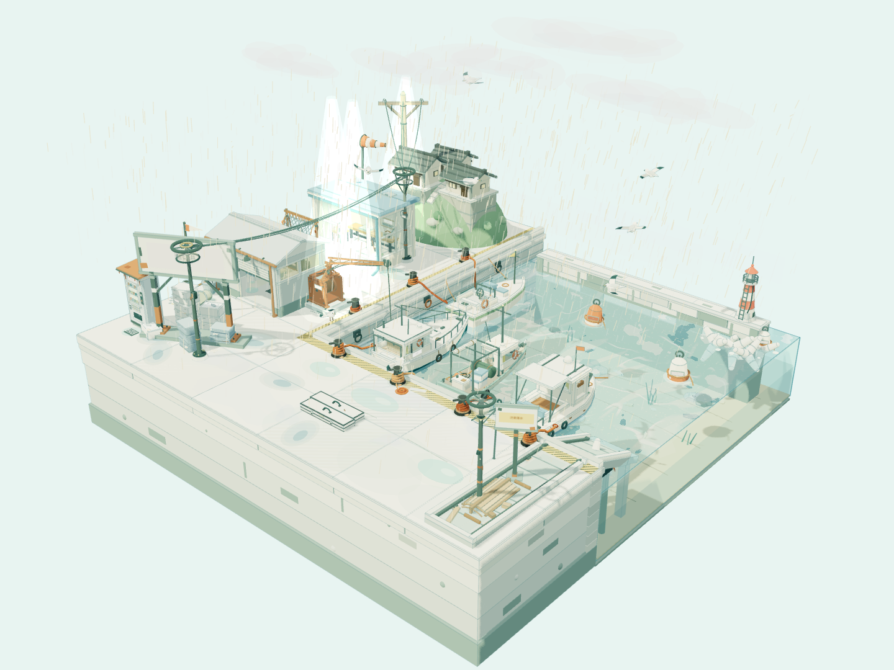
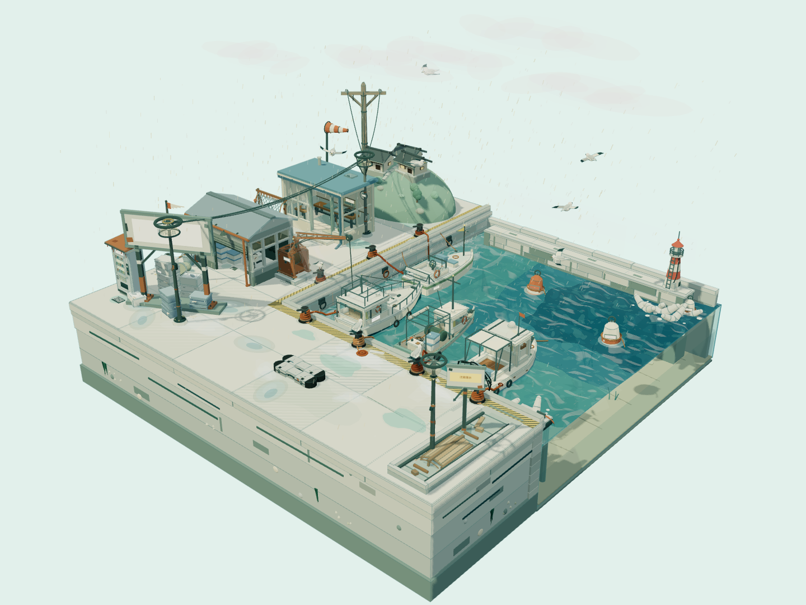
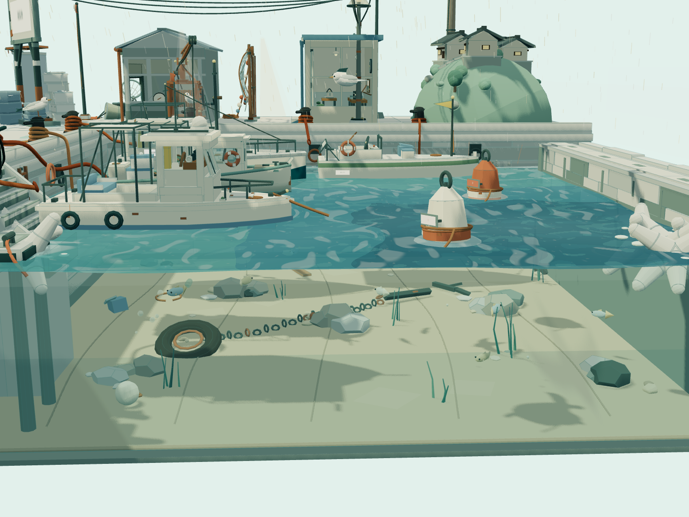
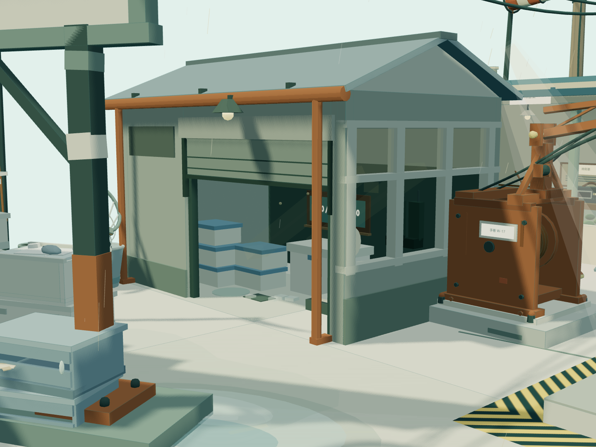
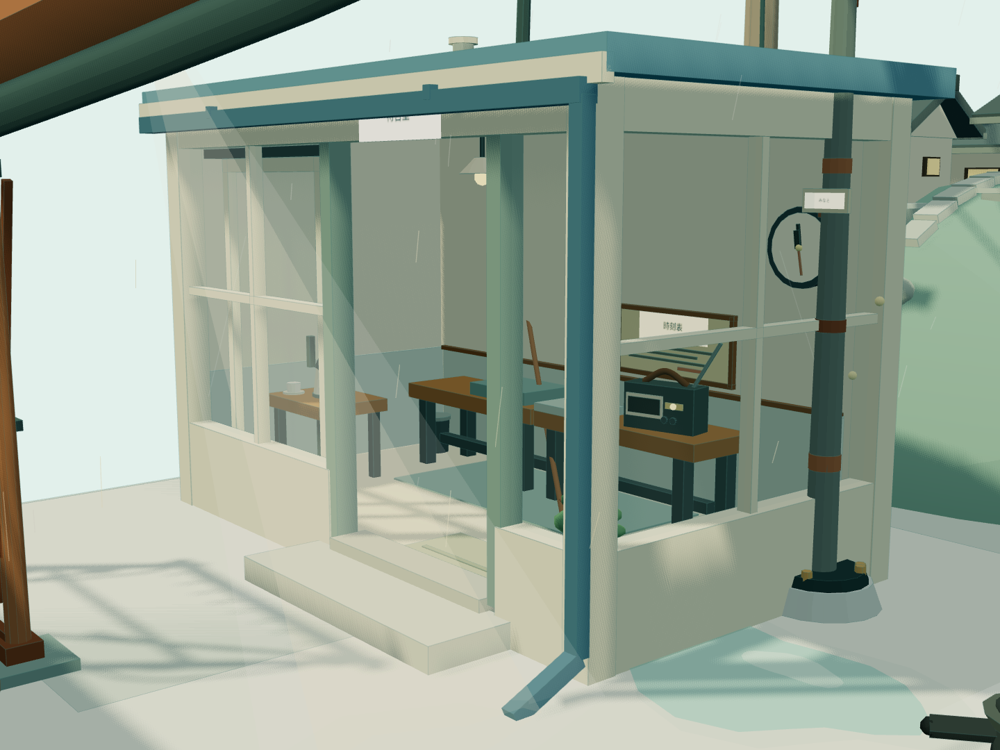
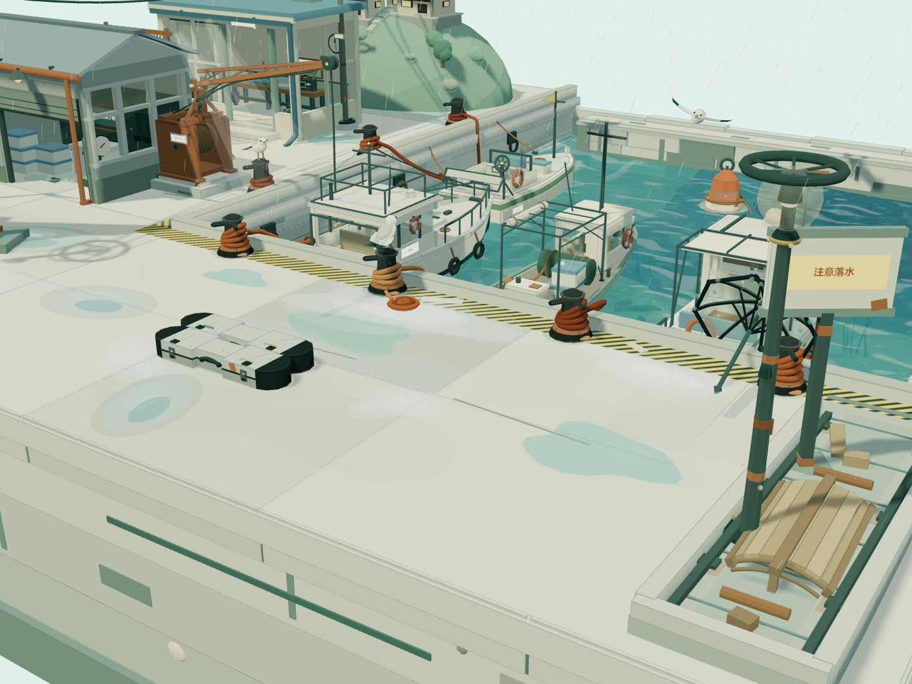
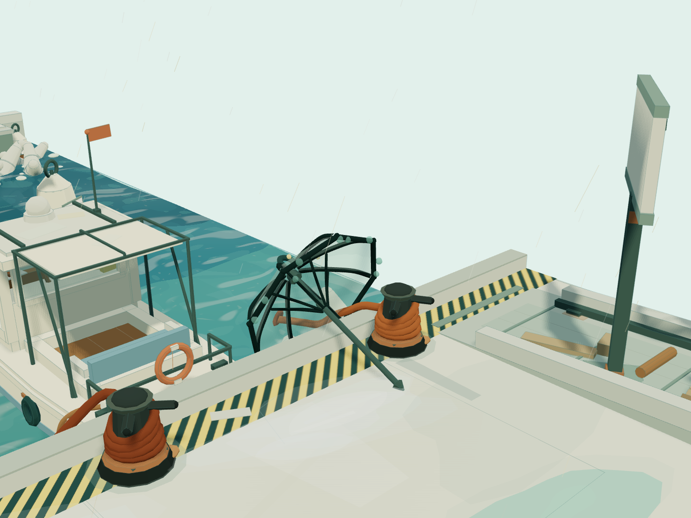
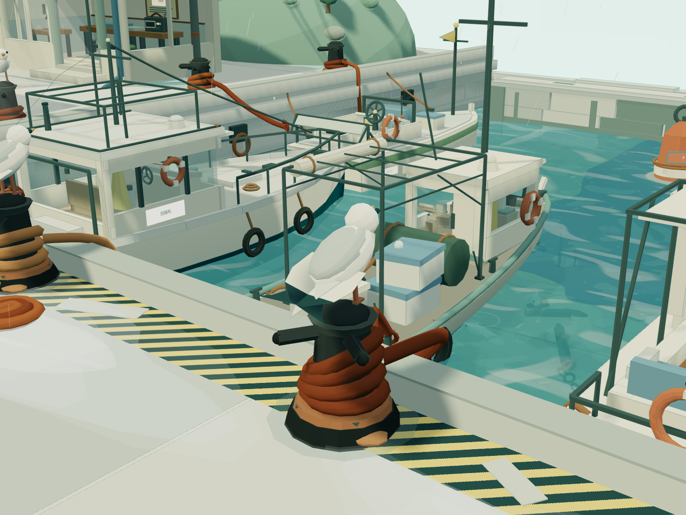
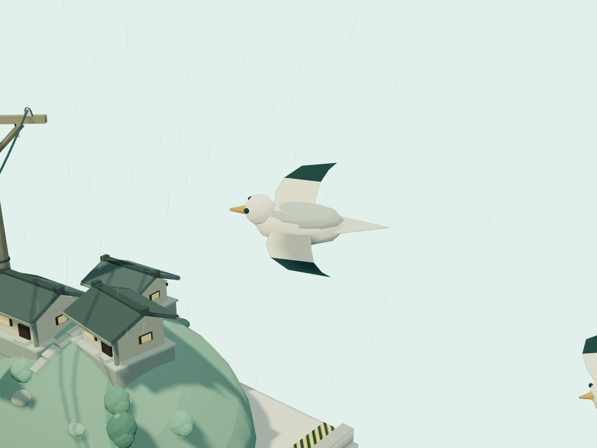
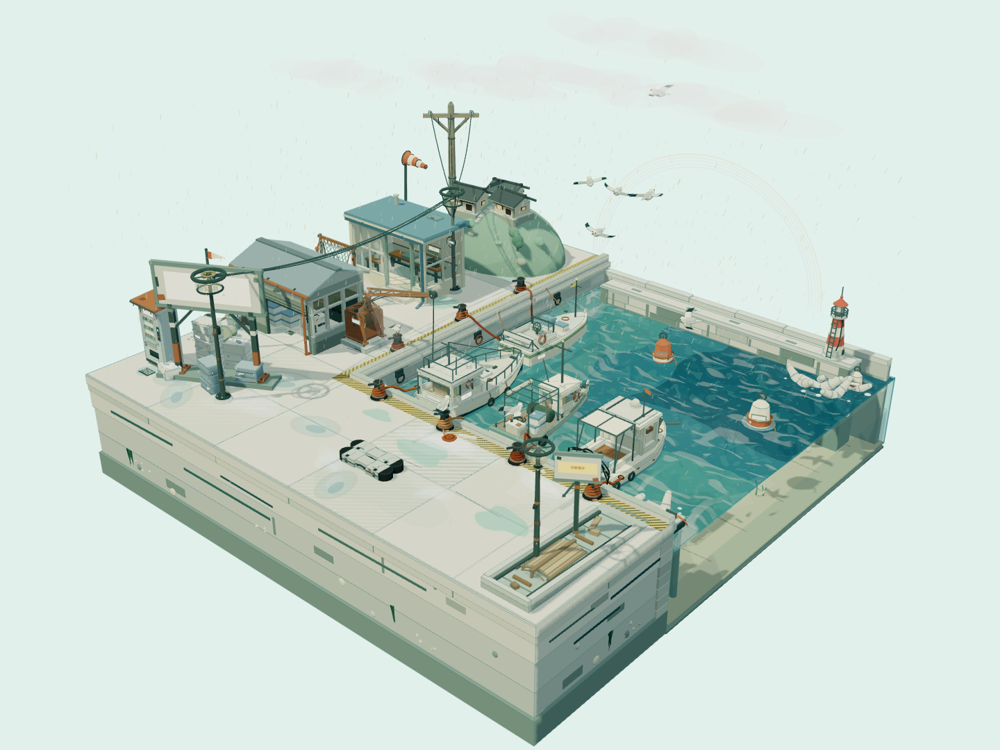

# 真实项目验证：太阳雨小渔港

## 概要

本例用同一批 37 名长期成员完成五轮 Three.js 场景制作，其中 32 位是组件作者。模型均使用 DSH 已配置的 `cn:deepseek-v4.1-flash`、最高思考档与原图像能力，未更改连接的上下文或输出上限。公开内容只有生成源码、依赖许可证、截图及脱敏验证摘要，没有个人模式、人设、账号、连接配置或原始会话。

测试驱动固定模块分工和版本化方案，用于验证执行、交接、双军师、独立复核及长期复用。它不代表整套大项目分工完全由模型自行生成；自然语言自动建队由另一新会话单独验证，结果见[测试报告](test-report.md)。

## 首稿与后续轮次

| 阶段 | 材料与组织 | 累计验收任务 |
| --- | --- | ---: |
| 首稿 | 32 位作者各写归属组件，固定接口与坐标；首份提交冻结，无外部渲染反馈 | 34 |
| 第二轮 | 真实截图与运行数据，调整光照、水色、细节及静态合批 | 44 |
| 第三轮 | 截图、边界数据与逐项审计；修订地面边界、伞、雨与光 | 52 |
| 第四轮 | 原成员补齐岸壁、海床、四船遮阳架与水光、天气包络、远堤和故事物件 | 66 |
| 第五轮 | 原作者补齐海鸥着陆收翅、缆绳松紧和克制云影；浏览器逐项采样动作 | 71 |

37 人包括主沟通者、双军师、独立复核者、集成人及 32 位作者，部分作者同时承担组长或后续独立验证职责。每轮检查身份列表，结束后再用最终插件冷启动原会话：仍是 37 名成员、71 项完成任务，模型实际回复，完成成员没有重新执行，源文件和发布文件未变。

oneshot 的含义是第一份正式组件提交，不是每人只调用一次 API；成员可读取接口、做自己的静态检查。公共骨架、辅助函数、入口、构建与分工由 QA 驱动提供。32 份首稿组件逐字节匹配不可变的首次提交回执。其中 `21-slipway.js` 首次被退回，在第一轮内修订后才验收，因此冻结首稿与第一轮最终验收文件是 31／32 相同；冻结稿有意保留原始提交。相较首稿，最终有 20 份组件不同，这个数字也包含第一轮内的修订，不能全部算作后四轮改动。QA 另修复了重建场景时主光基准随当前照度累积的问题，并通过连续重建验证；打包补充了 favicon 与完整依赖许可证。这些不属于组件作者的首份成果。

全程有五个执行版本被退回。海鸥任务曾以相同文件重新提交，复核者依据新增证据改变判断；文件相同并不表示第一次就已验收。公开示例保留这些限制，不将第一次提交、第一轮验收和最终成品混为一个结果。

## 实际效果

首稿：

五轮之后：

两版都保留正方形剖面底座、L 形码头、四船、仓库、候船室、山坡民家、灯塔、箱筐与港口器具，没有人物和页面 UI。后续版本降低大片过曝光感，强化青绿水面、玻璃内陈设和暖色小物；细节仍采用概括的低对比卡通造型，不是照片级重建。

上述近景在外部 QA 中调整相机及缩放约束，便于核对小物件，不等于默认控制器可以直接进入室内。普通使用中的拖拽、旋转和滚轮缩放另有实际交互检查。

## 性能与运行证据

| 同机主视角样本 | 首稿 | 第五轮 |
| --- | ---: | ---: |
| drawCalls | 7426 | 5169 |
| geometries | 3842 | 2076 |
| 注册动画组 | 89 | 110 |
| 加载组件 | 32 | 32 |
| 浏览器／资源异常 | 0 | 0 |
| 页面 UI | 0 | 0 |

静态合批降低了一部分提交和几何开销，同时保留船体、雨、鱼、旗、网等动态结构。第五轮加入细节后，主视角 drawCalls 仍比首稿约低 30%，geometries 约低 46%。这是具体机器、视角与时刻的数据，不能推断所有 GPU 的帧率；帧时还受同时运行程序影响，因此不作为跨设备速度排名。

最终普通浏览器检查确认拖拽、缩放和动画推进，另有 14 个外部细节视角。完整未合批对象的 CPU 包围盒检查未发现非有限几何节点；地面与工具越界问题已在初始采样中收回。此检查排除空几何，不能推算 GPU 独有变形或所有运动时刻的极值。

## 动作逐项核对

外部检查在 26 个受控时间点读取实际场景：脚底与系船柱顶接触、停留时收翅、离开再返回；缆绳柱端固定、船端和弧垂变化、表面不穿混凝土、几何对象复用；云影主光围绕原基准变化不超过约 3%、补光不变；灯塔和彩虹在预期窗口出现和消退。连续重建三次时主光基准保持。采样覆盖这些明确条件，不推论所有可能姿态、所有设备或完整物理模拟。

初版检查把 renderer 的 GPU 几何登记数当作场景对象数，切换近景时因延迟上传而失败。调查后保留原结果，改为比较整个场景的几何对象引用，并单独保留 GPU 计数。最终检查通过；这不是排除所有内存泄漏的证据。

## 偶发动画的验证方法

外部脚本为灯塔和彩虹分别采样约 62 秒与 92 秒的动画时间。它在浏览器中调整 RAF 时间戳，不修改场景源码；这是加速时间采样，不是声称实际等待了这些时长，也不代替插件三小时恢复测试。普通动效的连续变化由正常时间运行另外检查。

## 仍然存在的限制

- 整体景观和近景是不同的验收尺度，小型仪表、纸张、杯子和附着物需要特定视角才辨认得清；牌子、船顶和玻璃边框仍会造成遮挡。
- 水面和地面倒影主要由概括色块、薄层与细线表达，不是逐物体的完整物理反射。
- 静态几何、接口、文件归属和运行检查可以复现；柔和感、细腻程度与全部微观艺术要求不能由计数自动判定为完美。
- 未做全部显卡、移动浏览器、触摸手势、长周期全部姿态及真实低端设备验收。系统字体也可能改变标签外观。
- 测试中的军师和验证者是独立会话与独立决定，但同型号模型的两份意见不能代替外部实测或证明统计独立。

这些不足没有通过删减原始需求或改写用户授权来消除；源码、首稿摘要和实际图片一起提供，便于后续继续改进。

## 如何使用示例

源码与预构建静态文件位于发行源码／部署包的 `demos/harbor/oneshot` 和 `demos/harbor/multiround`，该示例不放入插件运行依赖。进入 `demos/harbor`，执行 `python -m http.server 8123 --bind 127.0.0.1`，分别打开浏览器路径 `/oneshot/dist/` 与 `/multiround/dist/`。修改后在对应 app 执行 `npm ci`、`npm run build`。

`first-component-sha256.json`、`final-component-sha256.json` 与 `verification.json` 用于核对版本。重新验证可运行仓库的 `scripts/scene-smoke.py`、`scripts/scene-detail.py` 和 `scripts/scene-motion.py`；依赖与浏览器准备见[验收矩阵](test-matrix.md)。Three.js 的完整 MIT 许可随两个 app 与构建输出保留。
