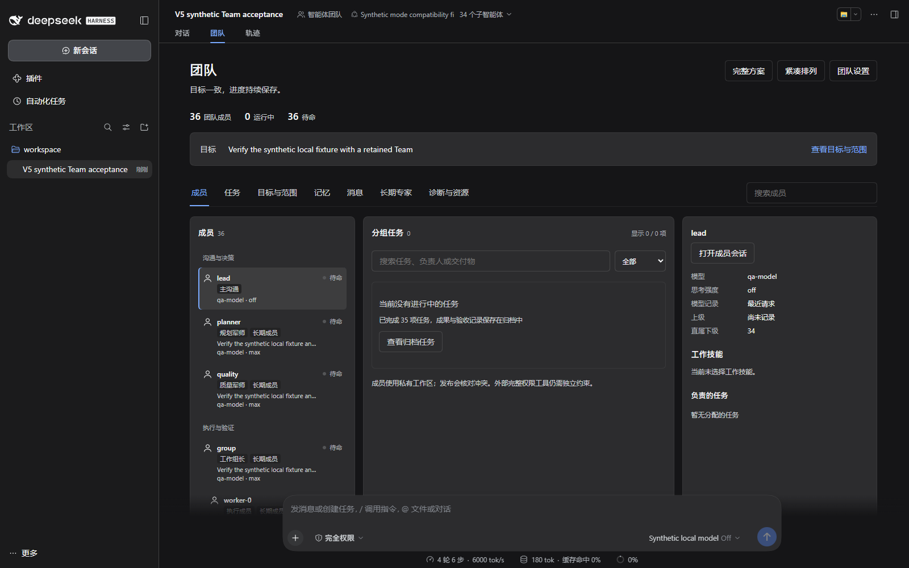

# V5 隔离测试报告

本候选版为 `0.5.0-rc.1`，内部修订 `20261107.6`。测试使用独立源码、独立 DSH home、随机端口和官方 npm `0.2.1-rc.2` 宿主，正式服务未部署。当前完整结果以[机器可读发行证据](release-evidence.json)为准：`testing` 表示仍有验收进行中，只有 `candidate-validated` 才允许生成最终发行 ZIP。

## 代码与兼容回归

| 检查 | 结果 | 范围 |
| --- | --- | --- |
| 核心与工具 | 395 项通过 | 目标、任务、双军师、记忆、技能、并发、文件、取消及恢复 |
| 客户端 | 110 项通过 | 层级、模型控制、筛选、分页、空态与错误 |
| 兼容提供方 | 987 项通过，2 项条件跳过 | 工具、沙箱、子代理、搜索与抓取 |
| 严格类型 | 139 个源码文件通过 | Host 与 Client 消费者分别检查 |
| 构建 | 9 个模块、56 个目录项 | 主 bundle、8 个内部模块；55 个专业技能及入口 |
| 源码清单 | 检查通过 | 包入口、精确 peer、许可证、链接、私有路径及宿主源码混入 |

合计 1492 项测试通过。跳过的两项分别涉及 enforcing provider 的符号链接 cwd，以及无目录搜索权限行为；当前 Windows 不执行这些 Unix 条件用例，它们不是已通过。

开发宿主固定于官方提交 `687f282e8625c6b8d11ff58211a90524be2e4317`。原生模块与 `build:lib` 已完成；完整官方 Web 构建曾遇到 Windows esbuild 临时文件 AccessDenied，因此没有把官方完整构建记为通过。实际 GUI 验收使用官方发布的 npm 宿主，插件本身独立构建。

## 真实宿主与浏览器

测试通过发行 `.tgz` 安装及受支持的 `dsh web` profile 运行，使用原生目标确认和真实 HTTP 流式工具调用；不以直接调用内部任务函数代替整体流程。模型由本地服务模拟，不消耗真实模型额度。每次使用新的 home，目录选择使用官方测试 overlay。

| 用例 | 核对内容 |
| --- | --- |
| 8／20／32 路 | HTTP 屏障证明独立执行请求确实重叠；人数之外另计双军师、复核人与主沟通者 |
| 孙代理 | 真正的父子会话；组长待命后仍可创建、续接与恢复原下级 |
| 原位换模 | 孙代理 A→B→A；ID、Session、任务与成果不变，真实请求采用所选型号 |
| 思考与长度 | 主沟通配置保持；成员按模型实际档解析；原任务输出上限保持，压缩请求单独识别 |
| 冷恢复 | 写入前停止并冷启动，execution／attempt／成员保持，待完成写入仅一次 |
| 文件交接 | 并行修改共同输入、同一作者连续改同一文件，最后版本正确发布，旧输入与提交仍能读取 |
| 军师要求修订 | 独立复核退回，沟通者明确重派原成员；只增加该任务尝试，不重跑已完成工作 |
| 联网 | 每名执行者实际调用搜索和抓取，连接本地 HTTP 提供方；不冒充全部公共搜索服务验证 |
| MCP | 真实 stdio echo 及停止后的进程退出；不代表任意第三方 MCP 已兼容 |
| Windows 命令 | 孙代理在私有工作区执行 Node／Python 文件与本地 curl；中文输出、准确工作目录、任务验收和冷恢复通过 |
| 多模态 | 孙代理实际读取 PNG，下一请求确有图像；专业理解另由真实项目验证 |
| 自定义 | 完整 profile 示例及额外技能根生效；已选正文进入成员，未选正文不进入沟通者 |
| 实际 UI | 所有页签、完整方案、末尾成员、搜索、诊断下载、深色和窄屏；模型、职责、退休与恢复实际点击 |

Node 22.19.0 与 24.13.1 分别验证。三小时用例在完成 35 项任务后保持 36 人团队待命，每十秒检查状态，约每十分钟冷重启一次，核对身份、执行、文件时间及唯一交付通知；已完成成员不能产生新模型请求。本次连续 10800 秒验证已通过，1060 次状态采样中任务与成员数保持，最长采样间隔约 35.64 秒，没有拼接中止的旧测试。178 次资源观察覆盖 18 个宿主进程，工作集约 174–417 MiB，包含冷启动波动。它不是三小时持续高负载，也不排除全部内存泄漏；完整字段见发行证据。

公开报告仅含合成信息和脱敏摘要，不含登录 URL、密钥或个人会话。布局与操作见[界面说明](ui.md)，逐项复现见[验收矩阵](test-matrix.md)。

## 本轮发现与修复

| 问题 | 修复与验证 |
| --- | --- |
| 官方宿主工具与内部接口不同 | 独立兼容提供方、明确服务替换及符号化宿主适配；真实 npm 安装后调用 |
| 父级待命使孙代理创建失效 | 程序恢复并暂留祖先，不额外唤醒父级模型；真层级与冷恢复验证 |
| 先发布一个依赖使其余输入失效 | 批量核对后按批准版本发布；并行修改及记录快照 |
| 同一成员继续改文件使旧提交失效 | 校验不可变归档；无归档旧记录仍检查原文件；连续修改、目录移除和篡改反例 |
| 发布后读不到原输入 | 创建任务时保存输入，按回执及偏移读取；真实模型工具调用 |
| 军师请求修订后无人处理 | 通知独立复核人核实并退回，再向沟通者发一条持久通知；单元、原生流程及真实返工 |
| 孙代理退休后父级待命无法恢复 | 验证保存的有效祖先关系；退休祖先仍拒绝；反例及按钮流程 |
| 继续后遗留未完成成员 | 有界接续原执行，跳过活动、已完成、冷却及待投递成员；冷恢复保持 attempt |
| 安装后成员拿不到工具 | 分别处理工具清单、继承上限、目标范围和实际准入；网络、MCP及模式技能检查 |
| 包依赖本机路径和未发布模块 | 8 个模块随包提供，宿主依赖外置，清单与哈希门禁；独立安装及回滚 |

测试还遇到 npm registry 连接重置、测试机内存压力及夹具字段错误。网络恢复后用新目录重跑，大用例改为分批执行，夹具修正后重新核对事件。中止用例未计为通过，未完成的持续运行没有拼接冒充三小时。

## Windows 执行验证

Windows 额外命令测试使用显式批准的完整程序执行范围。PowerShell 5.1.19041.3693 与 7.6.9 下独立脚本方式均通过，Node／Python 的实际工作目录一致且位于成员私有目录，中文输出保持。另以中文及空格路径建立全新 home，Node／Python／curl、任务验收与冷恢复通过。5.1 下最初的内联／管道方式未得到完整输出；没有将这些失败计为通过，也没有据此关闭成员的私有工作区限制。执行规范与部署建议见[自定义指南](customization.md)。

## 发布入口与类型

构建后的 13 个 Host、3 个 Client 类型入口通过独立消费者检查，翻译函数和会话标识没有退化为 any；移除本地类型扩展时，反向用例能检出错误。发现并修复了声明输出丢失本地语言和原生 UI 扩展的问题。检查使用固定宿主的已构建声明环境，跳过宿主声明内部检查，不冒充所有原生前端包的裸 NodeNext 检查已经通过。

此项修复只改变四份 `.d.ts`（模块与内嵌副本各两份）；423 项非声明运行、配置和技能文件与动态验收归档相同。最终发布证据同时保留原动态归档摘要、最终全清单摘要、独立执行文件摘要及声明修复记录，不能通过更新类型摘要放行另一份执行代码。

额外执行的通用 publint 对五个兼容模块通过，对主 bundle、runtime、tools、ui 返回静态规则错误：内嵌 file 依赖、用于保留源码的嵌套 exports，以及宿主浏览器工厂加载形式。没有将这些错误记为通过或全局关闭检查；本版交付方式是经过真实安装验证的完整 `.tgz`，内部模块不支持拆开安装或当作普通浏览器 ESM 入口使用。独立 npm registry 发布仍需命名空间与打包形式的单独核验。

## 真实模型项目

另行使用用户已配置的 `wb-remote`／`cn:deepseek-v4.1-flash`／`max` 测试真实项目。上下文、输出上限与图像能力沿用原配置，没有身份替换、渠道伪装或付费模型横评。发行包不含连接凭据、实际地址或原始请求。

太阳雨小渔港首轮由 32 位组件作者分工，第一份提交单独冻结；双军师、复核者、集成人及主沟通者计入后共 37 人。oneshot 指未接收外部渲染反馈的首份提交，不是每人只调用一次 API。场景骨架、公共接口与构建由测试驱动提供，不能归算为组件作者的首份成果。

后续轮次复用同一批身份与 Session，成员通过 `read_image` 看真实截图再修订，军师只做关键决策和审核。首稿与各轮源码、观察分开保存，浏览器构建与动效核对独立于模型自述。五轮累计验收 71 项任务；最后使用最终插件恢复原会话，37 个身份和 71 项结果保持，完成成员未重新执行。首稿主视角为 7426 drawCalls／3842 geometries，第五轮为 5169／2076；数据随视角、时刻和机器变化，不是通用 FPS 保证。[完整项目案例](harbor-case-study.md)附首稿／成稿源码、校验清单、实际图片、14 个细节视角、26 个受控时刻的动作核对和不足。

第五轮从逐项需求核查发现真实缺口：静态栖鸟没有完整着陆过程、缆绳只有刚体摆动、云层未改变地面照度。原作者分别修订，独立复核后由浏览器测量脚底与柱顶、翼姿、绳端与弧垂和主光强度。QA 骨架另修复主光在重建时累积基准的问题。初版 GPU 计数检查因视角变化触发延迟登记而失败，保留原记录后改用场景几何引用检查；最终通过，不将其当作完整泄漏证明。

第五轮确认后至交付期间，10 个活动角色的 49 份实际请求头均保持指定 Flash Max 与 393216 输出上限。期间有 3 次被拒工具调用：1 次旧模型步骤跨过目标确认版本，2 次把 PNG 交给文本读取工具。后续使用新步骤及图像工具完成任务；不能把任务最终完成描述成所有调用第一次就成功。

用户恢复任务后，在 2026-11-07 20:38（UTC+8）实际请求指定 Flash Max，返回 HTTP 200 和预期标记；随后在全新安装的 DSH 会话真实读取合成文件，正确回答 42，工具错误为零，输出上限保持 393216。该结果证明当时可用，不保证后续额度或服务状态；报告与发行包不包含真实连接地址或凭据。

自然语言建队另用新会话验证，没有预先塞入目标：模型自行生成方案，原生确认后完成 3 项任务、独立复核及最终交付。实际请求头均为指定 Flash Max，任务输出上限 393216。测试驱动的结果标签最初误写成清单首项 `cn:auto`，已根据实际请求更正，真实路由未发生该错误。

自然语言测试有 8 次被拒调用：5 次把未来输出当作现有输入、1 次漏复核证据、1 次旧任务版本、1 次读取范围外内部元数据。模型纠正后完成任务。这不构成第一次调用全部正确的证明，也不能因此放松路径、证据和版本检查；帮助与流程清晰度仍可继续优化。

## 保留与自定义

独立源码另外复制到全新目录，完成锁定依赖安装、开发 fixture、严格类型输出、构建、源码检查与 npm 打包。首次重建发现浏览器两份生成注释带入外部开发目录；固定构建目录与符号链接处理后，再从不同工作目录构建，713 项受保护文件与动态验收归档逐字节一致。其后四份声明修复单独通过消费者检查，非声明文件保持原字节；没有用未验证的执行代码替换动态验收版本。

另从最终 Git 索引导出新的源码目录，重新安装、编译、检查声明及打包，713 项文件匹配最终清单。内容固定的技能、生成文件和保留原换行的构建输入使用精确字节检出；上游资料的少数空白例外有路径限制，并实际验证普通源码及保留 CRLF 的源码仍会拒绝错误行尾空格。Git 暂存中没有 private-qa、node_modules、source fixture 或凭据文件。

加入第五轮示例与最新文档后，再以 Windows `core.autocrlf=true` 暂存和导出 897 份公开文件：408 份不含内嵌副本的受保护文件，以及首稿／成稿的 64 份组件摘要均未变化，空白检查通过。这个检查核对实际 Git 换行行为，不把文件数量当作专业质量评分。

开发与测试位于隔离目录，正式 profile、模式、模型配置及人设未参与切换，不读取人设正文。安装助手在新 home 完成 9 条命令验证：默认只计划、配置迁移、显式选择保留、失败后的 profile 字节及依赖目录回滚、Session 哨兵保留与移除。

使用者可选择主模型、成员模型和思考档，定义职责、指令、层级、任务图、独占资源、并发池、工作集及技能预算。模式 skills 与插件 skills 保留原优先级，额外技能先发现名称用途，选择后才加载正文。示例包含完整自定义 profile 及两个可选技能，见[自定义指南](customization.md)和[技能专册](skills.md)。

发行门禁核对经过测试的运行代码、配置与技能摘要及包内校验清单；文档更新不能带入另一份未测试运行代码。源码 ZIP 与部署 ZIP 分别提供 SHA-256，打包拒绝私有路径、凭据样式、会话及链接文件。

## 跨平台 CI 修正

首次 GitHub CI 在插件测试前因工作目录和 Corepack 选择的 pnpm 版本失败；现固定为宿主声明的 pnpm 11.28.5，并从宿主目录构建。第二轮暴露 Node 22 内置 npm 10 对锁文件的检查差异、Windows 临时目录短路径与真实路径不一致，以及固定 Playwright 1.60.0 在 Ubuntu 26.04 镜像上的安装限制。

锁文件已由 npm 10.9.3 补齐嵌套 TypeScript 依赖，项目 TypeScript 6.0.3 不变；实际 Node 22 安装通过。清理测试改为比较双方真实路径，并拒绝删除临时目录本身或其上级；通过真实 Windows 目录联接运行全部 395 项核心测试，旧比较会拒绝的路径现能安全清理。Linux CI 固定为 Ubuntu 24.04，保留 Windows／Linux 与 Node 22／24 四组及全部原检查。最终 CI 是否通过以对应提交的 GitHub Actions 结果为准。

## 限制

本版明确支持 DSH `0.2.1-rc.2`。`0.2.2-rc.1` 声明检查失败，禁止强行安装。其他 RC、桌面 GUI、PTC 全流程、macOS／Linux、旧原生团队事件全量迁移及全部个人插件组合，不能由本机结果自动获得兼容结论。CI 配置存在与 CI 实际通过须分别说明。

应用内锁不能约束持有宿主完整权限的任意 shell 或 MCP；公共搜索、浏览器、设备及账户需部署环境单独接入。实际余额、账单、项目费用硬预算、跨机器调度、全部下游自动失效分析及语义去重仍属后续能力，见[V5 未完成能力](v5-plan.md#未完成能力)。

模型可能误用工具、判断错误或受服务限制；插件保留目标、来源、版本和证据，不能保证所有专业任务一次成功或模型永不出错。报告保留这些限制，不以永远无 bug 替代可复现测试。
