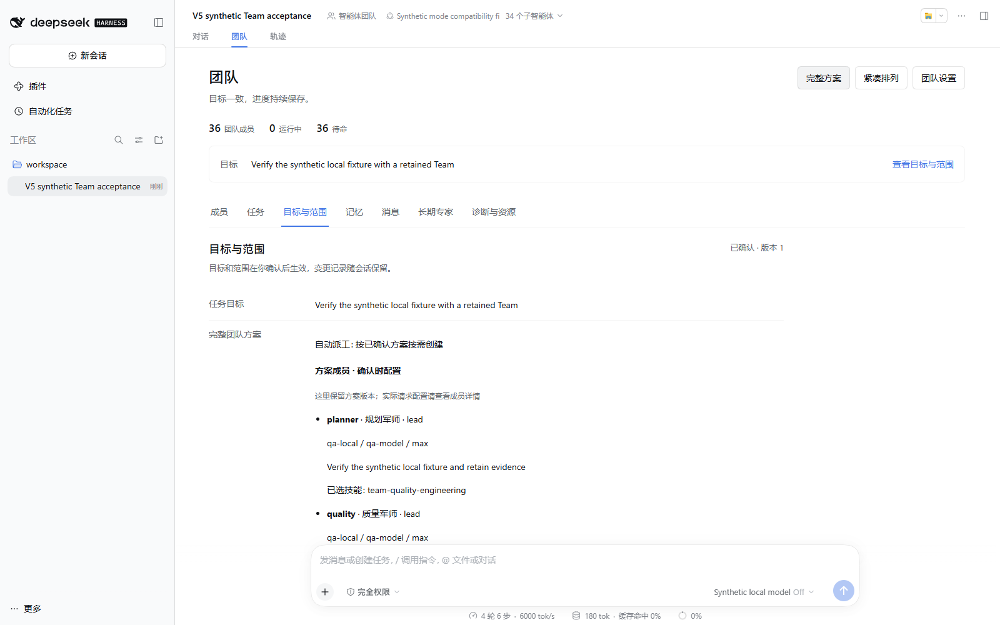
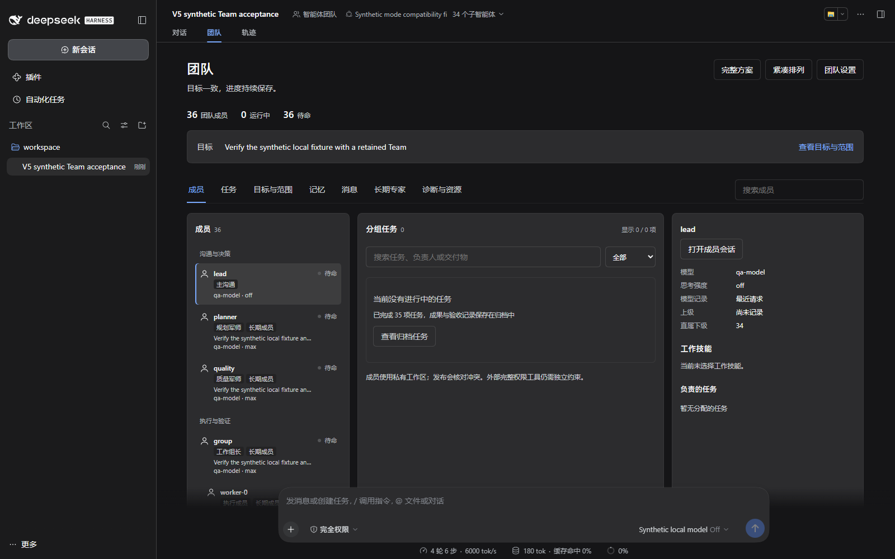
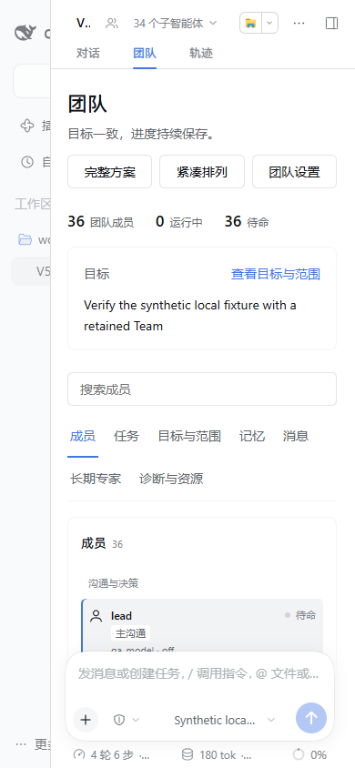
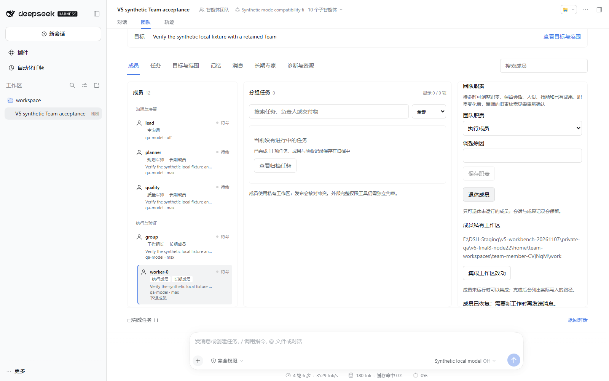

# 工作台界面说明

## 概要

界面展示真实 Session 投影，沿用 DSH 的主题与控件。下方图片来自隔离宿主和合成项目的实际流程，不是将设计稿冒充已实现页面；不包含用户会话或人设。

## 三栏与分组

左栏按沟通与决策、长期专家、执行与验证分类，显示当前模型、思考档与真实父子关系。中栏展示当前活动任务与分组，已完成任务通过归档查看。右栏随成员或任务选择联动，展示模型、技能、成果、证据和版本。

“待命”表示没有正在执行的模型步骤，不表示任务已经完成；等待审核、额度、依赖或资源有各自提示。缺少运行状态和摘要时显示同步中。界面将团队成员与原模式子代理分开，宿主顶部的直属子代理计数与整棵团队树口径可能不同。

## 完整方案与验收

完整方案可查看全部成员和阶段，而非只显示三条摘要。目标确认绑定具体版本；模型、岗位、技能、输入输出与逐项验收都可核对。接受结果必须有独立复核，关键结果还需两位军师决定，不能由作者或单模型自行宣称完成。

## 深色与窄屏

宽屏采用独立滚动的三栏，窄屏转为纵向内容；标签支持方向键与 Home/End，按钮有焦点状态。宿主右侧文档栏展开时可用空间变小，可先收起右栏再查看三栏全貌。任务搜索与分页限制一次渲染的数量，不把全部历史一次塞进面板。

## 诊断

“诊断与资源”展示目标版本、派工方式、计划预算、等待复核和资源冲突等实际计数。导出只包含编号、版本与数量，不包含目标、人设、技能正文、文件路径或连接配置；供应商实际计费与外部系统隔离无法观测时会明确说明。

## 成员自定义与生命周期

成员详情提供 provider、型号、思考档、职责及调整原因，保存到原成员的下一次请求配置。运行中换模会显示当前与下次路由。退休用于保留历史的待命成员，恢复保留 ID、Session 与工作区；父级只需在保存的团队关系中有效，不要求消耗模型请求维持驻留。

